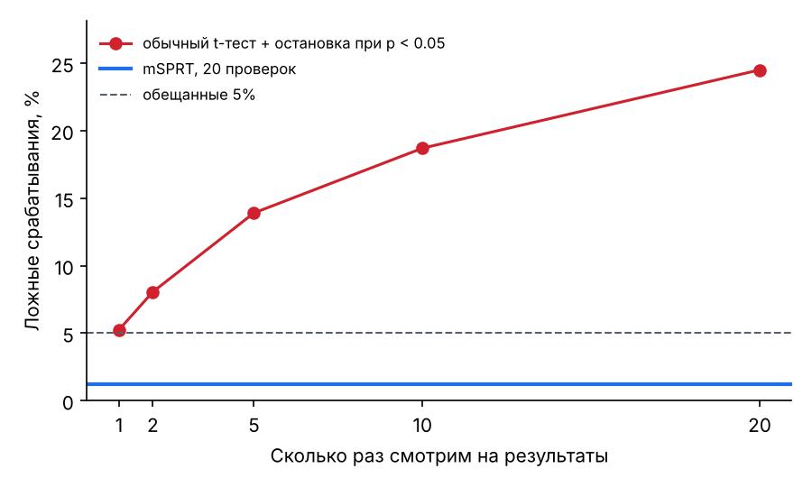
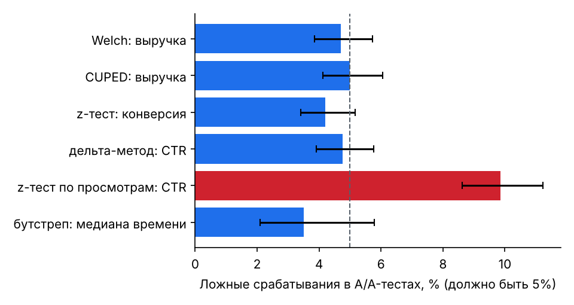

# honestab — A/B-тесты без самообмана

[](https://github.com/sofetizm/honestab/actions/workflows/ci.yml)
[](https://colab.research.google.com/github/sofetizm/honestab/blob/main/notebooks/demo.ipynb)


Python-библиотека для анализа A/B-тестов, в которой **каждый метод проверен симуляциями**.
Она проверяет SRM, применяет CUPED, считает ratio-метрики дельта-методом, делает поправку
на множественность и поддерживает последовательное тестирование. На выходе — готовое
решение: катить, не катить или не доверять результатам. В комплекте навык для ИИ-агентов
(Claude Code, Codex CLI и др.), который анализирует эксперименты с помощью этой библиотеки.

## Почему «честный»

Корректный статистический метод в A/A-тесте (эффекта нет) должен находить «эффект» в 5%
случаев — это и есть уровень значимости α = 0.05. Типичные ошибки аналитики ломают это
обещание. Числа ниже — из тысяч симулированных экспериментов ([`validation/`](validation/VALIDATION.md)):

| Ошибка | Что получается | Как надо (honestab) |
|---|---|---|
| Смотреть на p-value каждый день и остановиться, как только p < 0.05 | **24,5%** ложных срабатываний при 20 проверках | mSPRT: 1,2% |
| Считать CTR по таблице просмотров | **9,8%** ложных срабатываний | дельта-метод: 4,8% |
| Проверить 10 метрик и порадоваться значимой | **39,6%** шанс хотя бы одной ложной находки | поправка Holm: 4,8% |
| Не заметить, что в одной группе потерялась часть пользователей | «Эффект» в **99,8%** A/A-тестов | проверка SRM ловит 83,8% и блокирует решение |
| Не использовать данные до эксперимента | мощность 57,5% | CUPED: 75,3% при тех же 40 000 пользователях |



## Быстрый старт

```bash
pip install honestab
```

```python
import honestab as hb

report = hb.analyze(df, [               # df: одна строка на пользователя, колонка group = A/B
    hb.Metric("выручка", column="revenue", covariate="pre_revenue", role="primary"),
    hb.Metric("конверсия", column="converted", kind="proportion"),
    hb.Metric("CTR", numerator="clicks", denominator="views"),
    hb.Metric("сессии", column="sessions", role="guardrail"),
])
print(report.to_markdown())
```

Результат:

> **Решение: КАТИТЬ**

- Основная метрика «выручка» значимо улучшилась: +11.73% (95% ДИ +5.31% … +18.56%).

**Проверка SRM:** пройдена — размеры групп [29957, 30043], ожидалось [30000, 30000], p = 0.726

| Метрика | Роль | Метод | Контроль | Тест | Эффект | 95% ДИ | p | p (с поправкой) |
|---|---|---|---|---|---|---|---|---|
| выручка ✱ | primary | cuped | 279.1 | 311.9 | +11.73% | [+5.31%; +18.56%] | 0.000249 | — |
| конверсия | secondary | proportions | 0.1064 | 0.1084 | +1.90% | [-2.69%; +6.72%] | 0.423 | 0.423 |
| CTR ✱ | secondary | ratio (delta method) | 0.06723 | 0.06935 | +3.16% | [+0.73%; +5.65%] | 0.0106 | 0.0211 |
| сессии | guardrail | welch | 3.508 | 3.491 | -0.49% | [-1.56%; +0.59%] | 0.368 | — |

✱ — статистически значимо при α = 0.05 (вторичные метрики — с поправкой holm).

Примечания:
- выручка: theta = 0.1842; corr(y, x) = 0.566; variance reduced by ~32%

Что происходит внутри одного вызова:
1. **Проверка SRM**: если размеры групп не соответствуют плану, решение — «не доверять», и
   метрики не интерпретируются.
2. **Метод выбирается по типу метрики**: Welch, CUPED (если есть ковариата до эксперимента),
   z-тест для долей, дельта-метод для отношений, бутстреп для медиан.
3. **Поправка Holm** для вторичных метрик.
4. **Guardrail-метрики** блокируют выкатку, если значимо ухудшились.
5. **Решение с объяснением.** Если эффект не найден, отчёт сообщает MDE: какой эффект
   эксперимент вообще мог заметить.

## Командная строка

```bash
honestab analyze data.csv --config experiment.yaml          # отчёт в Markdown (или --json)
honestab design --kind proportion --baseline 0.05 --mde-rel 0.05 --daily 20000
honestab design --kind mean --baseline 280 --std 1100 --mde-rel 0.05 --variance-reduction 0.3
honestab srm 50120 49710
honestab example demo.csv --revenue-lift 0.05               # синтетический эксперимент + конфиг
```

<details>
<summary>Пример experiment.yaml</summary>

```yaml
group_col: group
control: A
treatment: B
expected_split: 0.5
alpha: 0.05
correction: holm          # holm | bh | none
metrics:
  - {name: revenue per user, column: revenue, covariate: pre_revenue, role: primary}
  - {name: conversion, column: converted, kind: proportion}
  - {name: ctr, numerator: clicks, denominator: views}
  - {name: median time, column: time_spent, kind: median}
  - {name: sessions per user, column: sessions, role: guardrail}
```
</details>

## Методы

| Задача | Функция | Суть |
|---|---|---|
| Среднее на пользователя | `hb.welch` | t-тест Уэлча; относительный эффект с интервалом Филлера |
| Снижение дисперсии | `hb.cuped` | CUPED: y − θ(x − x̄), x — метрика до эксперимента; дисперсия × (1 − ρ²) |
| Конверсия | `hb.proportions` | z-тест для двух долей |
| CTR, средний чек, выручка на сессию | `hb.ratio` | дельта-метод: учитывает, что события одного пользователя связаны |
| Медиана, перцентили | `hb.bootstrap` | перцентильный бутстреп |
| Подглядывание | `hb.msprt` | mSPRT: always-valid p-value и интервалы |
| Много метрик | `hb.holm`, `hb.benjamini_hochberg` | FWER / FDR |
| Потеря пользователей | `hb.srm` | χ²-тест размеров групп, порог p < 0.001 |
| Дизайн | `hb.sample_size`, `hb.sample_size_proportion`, `hb.mde`, `hb.duration_days` | размер выборки, MDE, длительность (с учётом CUPED) |
| Байесовский взгляд | `hb.bayes.beta_binomial` | P(B лучше A), ожидаемые потери |

Несколько решений, которых нет в «учебных» реализациях:
- **Интервал относительного эффекта по Филлеру.** Обычный дельта-метод для «+x%» иногда
  выдаёт интервал, включающий 0, при p < 0.05, и отчёт противоречит сам себе. Интервал
  Филлера исключает ноль ровно тогда, когда значим тест разности; это проверяется тестами
  на 40 случайных выборках.
- **CUPED с θ по объединённым группам**, без утечки эффекта в оценку.
- **Бутстреп кусками**: память ограничена даже на сотнях тысяч пользователей.
- **Результаты сверены с эталонами**: p-value и интервалы совпадают со scipy и statsmodels,
  дисперсия дельта-метода — с линеаризацией.

## Валидация

[`validation/run.py`](validation/run.py) прогоняет тысячи симулированных экспериментов и
проверяет оба обещания каждого метода:
1. без эффекта он ошибается в 5% случаев;
2. с эффектом находит его так часто, как обещает формула мощности.

Полный отчёт с доверительными интервалами — [`validation/VALIDATION.md`](validation/VALIDATION.md).

| Проверка | Результат |
|---|---|
| A/A-тесты: Welch, CUPED, z-тест, дельта-метод | 4,2% … 5,0% ложных срабатываний (норма — 5%) |
| Покрытие 95% доверительных интервалов | 95,0% и 95,1% |
| Ложные тревоги проверки SRM | 0,0% |
| Мощность при эффекте +10% к выручке | Welch 57,5%, CUPED 75,3% |
| Цена безопасного подглядывания | mSPRT находит эффект в 51,6% случаев против 82,3% у одного анализа в конце, но останавливается в среднем на 63% срока |

Один неочевидный вывод: если эффект мультипликативный (выручка × 1.1), разброс в тестовой
группе тоже растёт, и учебная формула размера выборки завышает мощность. В
`hb.sample_size` для этого есть параметр `std_treatment`.



## Навык для ИИ-агентов

[`skills/ab-test-analysis/`](skills/ab-test-analysis/SKILL.md) учит агента анализировать
эксперимент по шагам:
1. уточнить гипотезу и основную метрику;
2. привести данные к строке на пользователя;
3. проверить SRM;
4. выбрать метод;
5. запустить `honestab`;
6. написать отчёт с интервалами и MDE.

Навык не позволяет агенту объявить победителя по сегменту или «тренду к значимости».

```bash
npx skills add sofetizm/honestab
```

Или скопируй папку `skills/ab-test-analysis/` в `~/.claude/skills/` (Claude Code),
`~/.agents/skills/` (Codex CLI), `.github/skills/` (Copilot), `.cursor/skills/` (Cursor).

## Демо

[`notebooks/demo.ipynb`](notebooks/demo.ipynb) — полный разбор эксперимента с известным
истинным эффектом: дизайн и экономия трафика с CUPED → SRM → отчёт → почему CTR нельзя
считать по просмотрам → подглядывание → байесовский взгляд.

## Структура

```
src/honestab/
  methods.py       welch, proportions, ratio (дельта-метод), cuped, bootstrap
  design.py        размер выборки, MDE, длительность
  checks.py        SRM
  multiple.py      Holm, Benjamini–Hochberg
  sequential.py    mSPRT
  bayes.py         Beta-Binomial
  experiment.py    Metric, analyze, Report — от таблицы до решения
  datasets.py      синтетические эксперименты с известным эффектом
  cli.py           командная строка
validation/        симуляции, отчёт и графики
skills/            навык для ИИ-агентов
notebooks/         демо
tests/             сверка с scipy/statsmodels, свойства методов, CLI, сокращённые симуляции
```

## Разработка

```bash
pip install -e ".[dev]"
pytest                       # быстрые тесты, ~15 секунд
pytest -m slow               # сокращённые симуляции, ~2 минуты
python validation/run.py     # полная валидация, ~10 минут
```

## Ограничения

- Два варианта: контроль и тест. Для A/B/n сравни каждый вариант с контролем и сделай
  поправку на множественность.
- Методы асимптотические: для групп меньше нескольких сотен пользователей интервалы менее точны.
- Не учитываются сетевые эффекты (взаимодействие пользователей разных групп) и
  кластерная рандомизация (по городам, магазинам).
- mSPRT оценивает дисперсию по данным — это приближение, точное начиная с нескольких
  сотен наблюдений в группе (что и показывает валидация).

## Литература

- Kohavi, Tang, Xu. *Trustworthy Online Controlled Experiments*. Cambridge University Press, 2020.
- Deng, Xu, Kohavi, Walker. *Improving the Sensitivity of Online Controlled Experiments by
  Utilizing Pre-Experiment Data* (CUPED). WSDM 2013.
- Deng, Knoblich, Lu. *Applying the Delta Method in Metric Analytics*. KDD 2018.
- Johari, Koomen, Pekelis, Walsh. *Peeking at A/B Tests* (mSPRT). KDD 2017.
- Fieller. *Some Problems in Interval Estimation*. JRSS B, 1954.

## Лицензия

MIT
