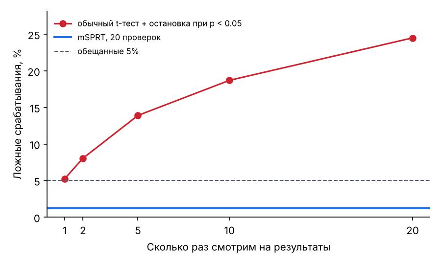
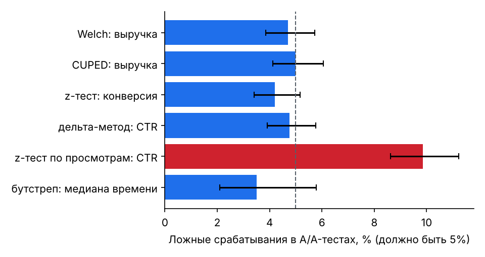

# Валидация методов симуляциями

Сгенерировано: 2026-11-03, 2.6 мин. В скобках — 95% доверительный интервал (Вильсон) для доли.

## 1. A/A-тесты: доля ложных срабатываний должна быть ≈ 5%

| Метод | Ложные срабатывания | Симуляций |
|---|---|---|
| Welch: выручка | 4.7% [3.9%; 5.7%] | 2000 |
| CUPED: выручка | 5.0% [4.1%; 6.0%] | 2000 |
| z-тест: конверсия | 4.2% [3.4%; 5.2%] | 2000 |
| дельта-метод: CTR | 4.8% [3.9%; 5.8%] | 2000 |
| z-тест по просмотрам: CTR ⚠️ | 9.8% [8.6%; 11.2%] | 2000 |
| бутстреп: медиана времени | 3.5% [2.1%; 5.8%] | 400 |

## 2. Подглядывание: проверка после каждой из 20 порций данных

| Сколько раз смотрим | Обычный t-тест, остановка при p < 0.05 | Симуляций |
|---|---|---|
| 1 | 5.2% [4.4%; 6.3%] | 2000 |
| 2 | 8.1% [6.9%; 9.3%] | 2000 |
| 5 | 13.9% [12.5%; 15.5%] | 2000 |
| 10 | 18.7% [17.1%; 20.5%] | 2000 |
| 20 | 24.5% [22.7%; 26.4%] | 2000 |
| 20, mSPRT (always-valid p-value) | **1.2% [0.8%; 1.8%]** | 2000 |

## 3. 10 метрик без эффекта: хотя бы одно ложное срабатывание

| Поправка | Вероятность | Симуляций |
|---|---|---|
| без поправки | 39.6% [38.1%; 41.2%] | 4000 |
| Holm | 4.8% [4.2%; 5.5%] | 4000 |
| Benjamini–Hochberg | 4.9% [4.2%; 5.6%] | 4000 |

## 4. Мощность: настоящий эффект +10% к выручке, 40,000 пользователей

Доля дисперсии, которую убирает CUPED (ρ²): 0.29.

| Метод | Мощность в симуляции | Формула с ростом дисперсии в B | Учебная формула (дисперсии равны) |
|---|---|---|---|
| welch | 57.5% [54.4%; 60.5%] | 56.4% | 60.7% |
| cuped | 75.3% [72.5%; 77.9%] | 71.2% | 75.5% |

Мультипликативный эффект увеличивает и разброс метрики в тестовой группе; учебная формула этого не учитывает и завышает мощность t-теста (в `hb.sample_size` для этого есть параметр `std_treatment`). На метриках с тяжёлыми хвостами, как выручка, и стандартное отклонение, и ρ² оцениваются неточно, поэтому формула мощности — ориентир с точностью до нескольких процентных пунктов. Вывод для дизайна: закладывайте запас по размеру выборки.

## 4б. Цена безопасного подглядывания

Настоящий эффект, обычный тест рассчитан на мощность ~80%.

| Анализ | Нашёл эффект | Симуляций |
|---|---|---|
| t-тест один раз в конце | 82.3% [79.8%; 84.5%] | 1000 |
| mSPRT, 20 проверок | 51.6% [48.5%; 54.7%] | 1000 |

Когда mSPRT находит эффект, он останавливается в среднем на 63% запланированной длительности.

## 5. SRM: потеря части пользователей создаёт фальшивый эффект

A/A-тест (эффекта нет). «Баг логирования» теряет часть пользователей с одной сессией в группе B.

| Ситуация | Метрика «сессий на пользователя» значимо выросла | Сработала проверка SRM |
|---|---|---|
| группы разделены правильно | 5.4% [3.7%; 7.7%] | 0.0% [0.0%; 0.8%] |
| в B потеряно 30% пользователей с одной сессией | 99.8% [98.9%; 100.0%] | 83.8% [80.3%; 86.8%] |

## 6. Покрытие доверительных интервалов (должно быть ≈ 95%)

| Интервал | Содержит истинный эффект | Симуляций |
|---|---|---|
| Welch, относительный эффект | 95.0% [94.0%; 95.9%] | 2000 |
| z-тест долей, относительный эффект | 95.1% [94.1%; 96.0%] | 2000 |

